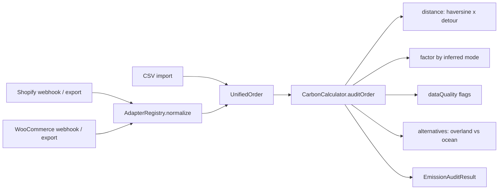

# Design: Carbon engine (foundation)

## Overview

`foundation/` is the Skeleton Crew template. It has no I/O except reading environment variables for the warehouse origin. Both apps call the same functions, so the CLI, the dashboard and the HTTP API always agree on a number (`ecotrace verify` checks this against a live server).

## Components

| Module | Responsibility |
|---|---|
| `engine/calculator.ts` | `E = d × w/1000 × f`, rating A–F, alternatives, data-quality block |
| `engine/emissionFactors.ts` | per-mode factors, whole-word carrier inference |
| `engine/geocoding.ts` | coordinates (exact → city table → country centre), haversine, detour factor, overland check |
| `engine/validation.ts` | `parsePositiveNumber`, `ValidationError`, limits |
| `adapters/*` | platform payload → `UnifiedOrder`, weight-estimation flag |
| `importers/index.ts` | RFC 4180 CSV parser, JSON shapes, per-row errors |
| `config/origin.ts` | warehouse origin from `ECOTRACE_ORIGIN_*` |

## Key decisions

1. **Whole-word carrier matching.** Substring matching classified "Seattle Ground" as sea freight and "Level Ground" as electric. Regex word boundaries fix this (R4.2).
2. **Estimate, then say so.** Platforms often send no weights. We still compute a figure (useful for ranking) but always set `dataQuality` (R3.2, R3.3). Hiding the uncertainty would make reports misleading.
3. **Geography-aware alternatives.** A coarse land-mass check plus an island-country list decides overland vs ocean. It is deliberately simple; the property test R2.2 makes sure it can never suggest physically impossible modes.
4. **Detour factors** (air 1.10, road/rail 1.20, sea 1.35) approximate real routes from great-circle distance without a routing API, so the CLI works offline.
5. **No floating `Math.max(0.1, …)` on weight.** The old clamp silently changed real light parcels. Now only invalid weights are replaced, and flagged.

## Error handling

Validation errors are `ValidationError`, which the web app maps to HTTP 400 and the CLI to exit code 1. Importers never throw for bad rows; they return `{ row, message }` entries.

## Testing strategy

- Property-based tests with fast-check for every requirement marked (Rx.y).
- Example tests for adapters, CSV quoting and formula-injection protection.
- Live end-to-end: `ecotrace verify <url>` compares the server's math to the local engine.
