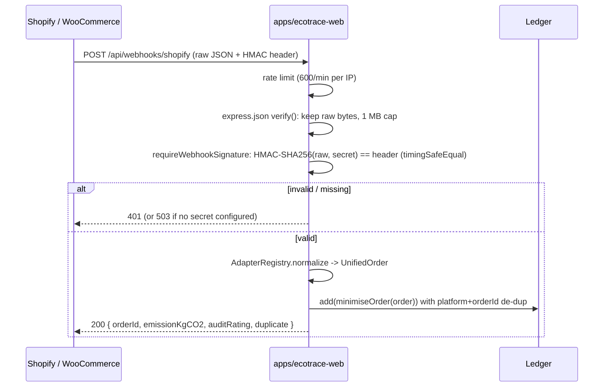

# Design: Signed webhook ingestion

## Request pipeline

## Why raw bytes

The HMAC must be computed over the exact bytes the platform signed. Re-serialising parsed JSON changes whitespace and key order and breaks verification, so `express.json({ verify })` stores `req.rawBody`.

## Endpoint classes

| Class | Endpoints | Auth | State |
|---|---|---|---|
| Webhooks | `/api/webhooks/{shopify,woocommerce}` | HMAC | writes ledger |
| Sandbox | `/api/sandbox/normalize`, `/api/calculate`, `/api/cli/execute` | none, 30/min | stateless (demo ledger only in demo mode) |
| Read | `/api/orders`, `/api/audit/summary`, `/api/kiro/run` | optional Bearer read token | read only |
| Admin | `/api/audit/reset` | admin token, or demo mode | destructive |
| Public | `/healthz`, `/api/meta`, `/api/kiro/specs` | none | no data |

## Removed

`/api/git/status` and `/api/git/push` were deleted. They built shell commands from request fields (command injection), stored a GitHub token in `.git/config`, force-pushed, and had no authentication.

## Persistence

`Ledger` writes `{ version, orders }` to `ECOTRACE_LEDGER_FILE` atomically (temp file + rename, mode 0600). Demo mode keeps everything in memory. The ledger is capped (5 000 orders, 200 log lines).

## Testability

`server/app.ts` exports `createApp(config)`; `server.ts` only adds the frontend and listens. Tests start isolated instances on random ports (`tests/server.security.test.ts`) and `ecotrace verify` runs the same checks against a deployed URL.
